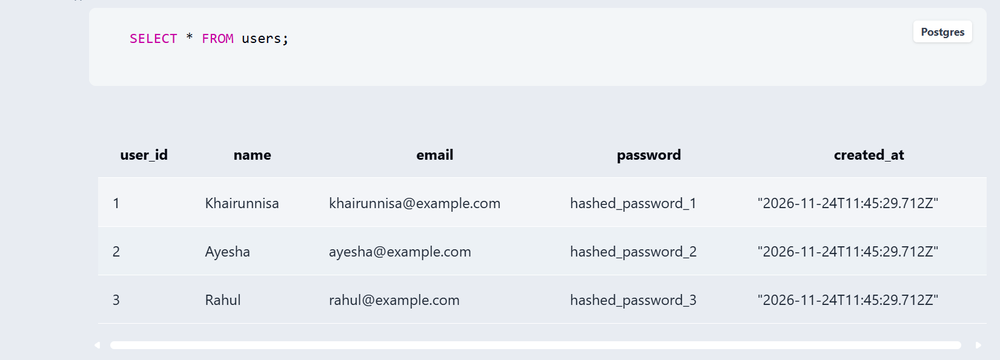
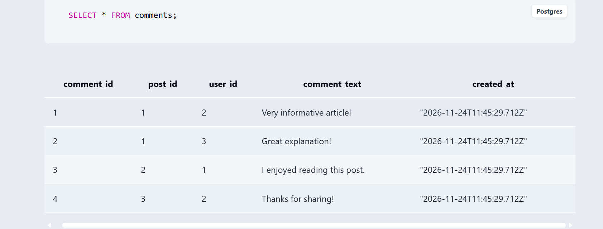
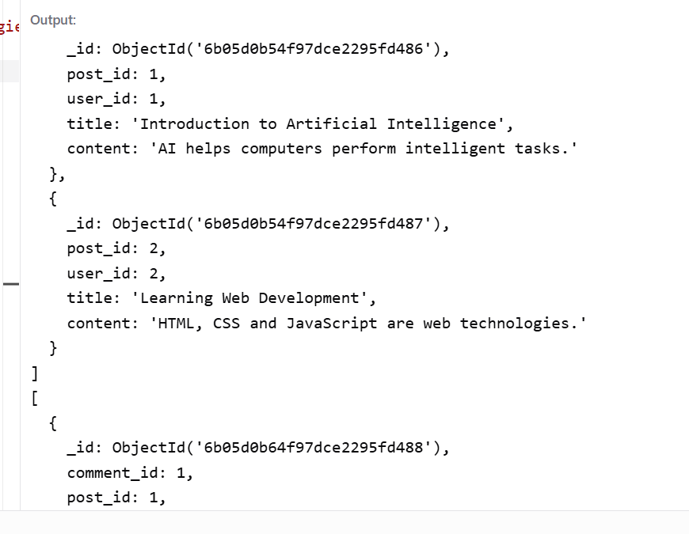

Database Basics – Blog Database Project

Project Overview

This project demonstrates the fundamentals of database management by designing and implementing a Blog Database System using SQL and MongoDB.

The database stores and manages users, blog posts, and comments. It demonstrates database relationships, data insertion, retrieval, updating, and querying.

Project Objectives

- Understand database fundamentals.
- Design a relational database schema.
- Create tables using primary keys and foreign keys.
- Understand one-to-many relationships.
- Insert and manage database records.
- Perform SQL queries using JOIN operations.
- Understand MongoDB collections and documents.
- Perform basic MongoDB operations.

Technologies Used

- PostgreSQL
- SQL
- MongoDB
- MongoDB Shell
- Visual Studio Code
- Git and GitHub

Database Design

This project contains three main tables.

1. Users

Column| Description
user_id| Primary Key
name| User name
email| User email
password| Password field
created_at| Account creation date

2. Posts

Column| Description
post_id| Primary Key
user_id| Foreign Key
title| Post title
content| Post content
created_at| Post creation date

3. Comments

Column| Description
comment_id| Primary Key
post_id| Foreign Key
user_id| Foreign Key
comment_text| Comment content
created_at| Comment creation date

Database Relationships

- One user can create many posts.
- One user can write many comments.
- One post can contain many comments.

Entity Relationship Diagram

Schema Diagram (SVG)

"Database Schema Diagram" (./screenshots/schema-diagram.svg)

SQL Implementation

The SQL implementation includes:

- Creating database tables.
- Defining primary keys.
- Defining foreign key constraints.
- Inserting sample records.
- Retrieving records using SELECT.
- Filtering records using WHERE.
- Combining tables using JOIN.
- Counting records using COUNT.
- Updating records using UPDATE.

SQL Files

- "schema.sql" – Creates database tables.
- "insert.sql" – Inserts sample data.
- "queries.sql" – Contains SQL queries.

MongoDB Implementation

MongoDB is used to store blog data in three collections:

1. Users
2. Posts
3. Comments

MongoDB Operations

- Insert multiple users using "insertMany()".
- Insert multiple blog posts.
- Insert multiple comments.
- Retrieve records using "find()".

MongoDB File

"mongodb/queries.js"

MongoDB Execution Output

The MongoDB operations successfully inserted:

- 3 user documents.
- 2 post documents.
- 2 comment documents.

"MongoDB Execution Output" (./screenshots/mongodb-output.png)

Project Structure

database-basics-blog/
│
├── README.md
│
├── sql/
│   ├── schema.sql
│   ├── insert.sql
│   └── queries.sql
│
├── mongodb/
│   └── queries.js
│
└── screenshots/
    ├── schema-diagram.svg
    ├── mongodb-output.png
    ├── schema-output.png
    ├── users-output.png
    ├── posts-output.png
    ├── comments-output.png
    └── join-output.png

Project Screenshots

1. Database Schema

[!"Schema Diagram"] (./screenshots/schema-diagram.svg)

2. SQL Schema Output

[!"SQL Schema Output"](./screenshots/schema-output.png)

3. Users Table Output

4. Posts Table Output

!["Posts Output"] (./screenshots/posts-output.png)

5. Comments Table Output

6. SQL JOIN Output

!["SQL JOIN Output"] (./screenshots/join-output.png)

7. MongoDB Output

!["MongoDB Output"] (./screenshots/mongodb-output1.png)

!["MongoDB Output"] (./screenshots/mongodb-output3.png)

Learning Outcomes

Through this project, I learned:

- Database design and schema creation.
- Primary keys and foreign keys.
- One-to-many relationships.
- SQL queries and JOIN operations.
- Data insertion, retrieval, and updating.
- MongoDB collections and documents.
- Basic database management concepts.

Author

Khairunnisa Ladkhan Athani

Final-Year Computer Science and Engineering Student

Conclusion

This project helped me understand the fundamentals of database management using SQL and MongoDB. It provided practical experience in designing database schemas, managing records, and performing database operations.